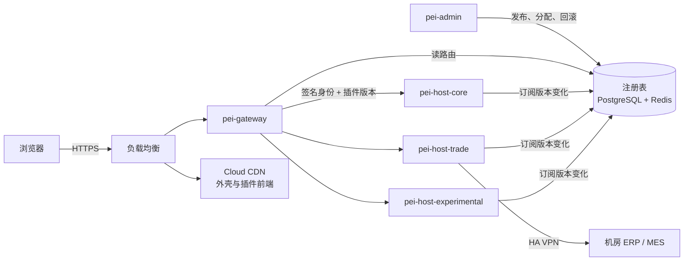
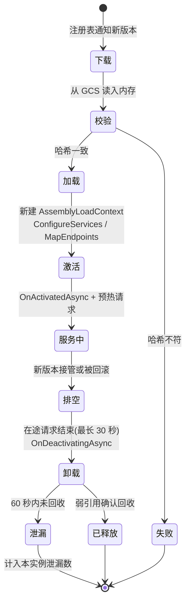

# 03 宿主池、隔离与资源配额(草案 v0.1)

本文给出第一版底座最关键的一项保证,以及实现它的机制:

> **任何一个插件出错,都不会让网关、Admin 或其他宿主池停摆。受影响的只是同一个池,并且在几十秒内自动恢复;反复出错的插件版本会被自动回滚。**

## 1. 服务拓扑

| 服务 | 形态 | 入口 | 实例 | 内网出口 |
| --- | --- | --- | --- | --- |
| `pei-gateway` | 内核网关,不加载插件 | 公网(经负载均衡) | 最少 2 | 否 |
| `pei-admin` | 控制面,不加载插件 | 公网,前置 Cloud IAP | 最少 1 | 否 |
| `pei-host-core` | 宿主池:核心业务 | 仅内部 | 最少 2 | 否 |
| `pei-host-trade` | 宿主池:交易 | 仅内部 | 最少 2 | 是(HA VPN 到机房) |
| `pei-host-experimental` | 宿主池:试验、新插件、示例插件 | 仅内部 | 最少 1 | 否 |

- 三个宿主池用**同一个镜像**,区别只在配置(池名、实例规格、服务账号、是否开内网出口)。池由基础设施代码建一次,之后发布插件不碰它们。
- 宿主池的入口设为“仅内部”,并且只允许网关、Admin 和调度服务的服务账号调用。浏览器无法直接访问宿主。
- 前端外壳的静态文件和插件的 ESM 走 Cloud CDN;网关只返回入口页面和 Import Map。

## 2. 一次请求经过什么

1. **网关**校验会话,得到内部用户 ID。
2. 网关按路径前缀在注册表中找到插件、它所在的池和当前生效版本,并检查用户能否使用这个插件(插件级权限)。
3. 网关签发一个**内部身份令牌**:有效期 60 秒,受众是目标池,内含用户、租户、语言、时区、关联 ID。然后连同 `X-Pei-Plugin-Id`、`X-Pei-Plugin-Version` 转发给宿主池。
4. **宿主**验证令牌,构造 `IRequestContext`,检查接口上的 `RequirePermission`(接口级权限),在该插件的并发上限和超时之内调用插件。
5. 宿主返回结果;网关记录状态码和耗时,用于熔断和自动回滚判断。

插件级权限在网关查,接口级权限在宿主查。宿主不信任任何没有有效令牌的请求。

## 3. 插件在宿主内的生命周期

- 插件包只读进内存,不落本地磁盘。
- 加载失败或预热失败时,新版本不接管流量,旧版本继续服务,并上报到 Admin。
- 卸载后用弱引用确认上下文是否真的被回收。没回收就记为一次泄漏;泄漏累计到阈值时,实例会被换掉(见第 6 节)。

### 数据库迁移由 Admin 执行,不由宿主执行

这一点与平台原设计不同:**迁移脚本在 Admin 发布插件时执行一次,宿主从不执行 DDL。**

- Admin 发布时先用 `pg_try_advisory_lock` 抢锁,再以该插件的**迁移角色**在它的 schema 里执行脚本。迁移成功,版本才会出现在注册表里。
- 宿主运行时用的是插件的**运行角色**,只有增删改查权限,不能改表结构。
- 好处:迁移只有一个执行点,不存在多个实例同时抢着迁移;插件代码即使出问题,也无法在运行时改表或删表。

## 4. 版本切换与回滚

1. Admin 在 PostgreSQL 中写入新的生效版本,并通过 Redis 发出通知。
2. 每个宿主实例收到通知后,按第 3 节加载新版本;收不到通知的实例每 30 秒轮询一次,作为兜底。
3. 实例把“已就绪的版本”回报给注册表。网关在**所有实例都就绪后**才切换路由;超过 2 分钟仍未就绪的实例会被换掉。
4. 上一个版本在每个实例中再保留 10 分钟。这段时间里,带旧版本号的请求(还没刷新的浏览器页面)仍然交给旧版本处理。
5. **回滚**就是把生效版本指回上一个版本。上一版本仍在内存里时立即生效;已卸载时从 GCS 重新加载,同样只需几秒。

## 5. 宿主内部的资源限制

同一个进程里,.NET 无法按插件限制内存和 CPU。所以我们在能控制的地方逐项设限,控制不了的交给第 6 节的“换实例”兜底。

| 资源 | 怎么限 | 超限时 |
| --- | --- | --- |
| 并发 | 每个插件一个并发闸门,上限取清单 `limits.maxConcurrentRequests` | 立即返回 503,不排队 |
| 请求时长 | 按清单 `limits.requestTimeoutSeconds` 取消请求 | 返回 504;插件不响应取消时计为一次“卡死” |
| 数据库连接 | 每个插件一个独立连接池,上限取 `limits.dbConnections` | 等待 5 秒后返回 503 |
| SQL 执行时间 | 在插件运行角色上设置 `statement_timeout` | 数据库中止语句 |
| 出站网络 | 按池在网络层开放;池内按插件在 `IHttpClientFactory` 的处理器中检查 `egress.hosts` | 拒绝请求并写审计 |
| 内存、CPU、线程池 | 进程内无法按插件区分 | 见第 6 节 |

**出站网络的按插件检查不是硬边界。** 插件如果绕过 `IHttpClientFactory` 自己建连接,池内的检查拦不住。为此上传时会扫描插件程序集,发现直接使用套接字或自行创建 `HttpClient` 就拒绝。真正的硬边界在池这一层:只有交易池能到达机房内网。

## 6. 故障检测与自动处置

| 故障 | 怎么发现 | 自动处置 |
| --- | --- | --- |
| 进程崩溃(栈溢出、`FailFast`、内存耗尽) | 网关到宿主的连接中断 | Cloud Run 自动重启实例;网关记录当时在途请求属于哪些插件 |
| 某插件反复导致崩溃 | 10 分钟内,某插件版本在 3 次崩溃中都有在途请求,而同池其他插件的请求在崩溃之外均正常 | 自动回滚该插件到上一版本;没有上一版本则停用。通知插件负责人 |
| 请求卡死不响应取消 | 宿主看门狗:请求超过超时时间的 2 倍仍未结束 | 1 个实例上卡死请求达到 5 个时,该实例停止接新请求、排空后退出 |
| 线程池饥饿 | 宿主监控线程池排队长度和调度延迟 | 对在途请求最多的插件打开熔断,随后换实例 |
| 内存持续升高 | 托管堆超过容器内存的 80% | 不再加载新版本;排空后换实例 |
| 卸载泄漏累积 | 本实例泄漏的上下文达到 3 个 | 排空后换实例 |
| 插件错误率升高 | 网关按插件统计 5xx 和超时 | 熔断:30 秒内 20 个请求中失败过半即打开,30 秒后试探恢复 |
| 整个池不可用 | 网关对池做健康检查 | 该池的插件在界面上显示“暂不可用”,接口返回 503;其他池不受影响 |

“换实例”的做法是:实例先告诉网关自己不再接新请求,等在途请求结束(最长 30 秒),然后自行退出,由 Cloud Run 启动新实例。新实例从注册表重新加载本池的插件。

## 7. 发布后的自动回滚

插件进入正式通道时:

1. 先只对 5% 的用户生效(按用户 ID 分桶,同一个用户始终落在同一桶)。
2. 观察 15 分钟,与上一版本对比错误率和 P95 耗时。
3. 出现以下任一情况就自动回滚,并通知发布者:错误率超过上一版本的 2 倍且高于 1%;P95 耗时超过上一版本的 2 倍;触发了第 6 节的崩溃归因。
4. 没有问题就全量生效。

开发通道和试用通道不做灰度,立即生效。

## 8. 资源配额与池规格

**插件级配额**(清单 `limits`,Admin 可按插件调高上限):

| 配额 | 默认 | 上限 |
| --- | --- | --- |
| `dbConnections` | 5 | 50 |
| `requestTimeoutSeconds` | 30 | 300 |
| `maxConcurrentRequests` | 100 | 1000 |
| 定时任务单次时长 | 300 秒 | 3600 秒 |

**池的初始规格**(上线后按监控调整):

| 池 | CPU / 内存 | 实例数 |
| --- | --- | --- |
| core | 2 vCPU / 4 GiB | 2–10 |
| trade | 2 vCPU / 4 GiB | 2–10 |
| experimental | 1 vCPU / 2 GiB | 1–3 |

所有宿主池都启用常驻 CPU(不在请求之间冻结),因为版本同步、看门狗和监控需要在没有请求时也能运行。插件自己仍不得启动后台线程。

## 9. 本地开发

本地不需要三个池,一个进程就够。本地模式下,网关、Admin 和一个宿主跑在同一个进程里,插件代码与云上完全相同。替代关系如下:

| 云上 | 本地 |
| --- | --- |
| Cloud SQL | 自建 PostgreSQL(见 08 号文档) |
| Memorystore for Redis | Redis 7 |
| Cloud Storage | 本地目录,由内核的存储适配器切换 |
| Pub/Sub | 进程内的内存事件总线 |
| Cloud Scheduler、Cloud Tasks | 进程内的定时调度 |

故障隔离只能在云上验证。所以第 10 节的测试在云上的 dev 环境里跑,不在本地跑。

## 10. PoC 验收测试

| # | 场景 | 通过标准 |
| --- | --- | --- |
| 1 | 试验池中的插件 A 触发栈溢出 | 网关和其他池零错误;试验池 60 秒内恢复;连续 3 次后插件 A 被自动回滚 |
| 2 | 插件 A 在请求中死循环,不响应取消 | 同池插件 B 的 P95 耗时上升不超过 2 倍;2 分钟内实例被换掉 |
| 3 | 插件 A 持续泄漏内存 | 实例在内存耗尽前被换掉;除该实例上的在途请求外,没有请求失败 |
| 4 | 插件 A 占满自己的数据库连接 | 同池插件 B 的数据库访问不受影响 |
| 5 | 同一插件连续升级 50 次 | 记录内存曲线;泄漏触发换实例的次数符合第 6 节的阈值 |
| 6 | 回滚 | 所有实例在 5 秒内(P95)切回上一版本 |
| 7 | 浏览器直接访问宿主池地址 | 被拒绝 |
| 8 | 插件尝试运行时执行 DDL | 被数据库拒绝 |

## 11. 待定

- 第 6、7 节的各项阈值都是初值,需要在 PoC 中按实测调整。
- 内部身份令牌的签名密钥放在 Secret Manager 还是使用 Cloud Run 的服务身份令牌,在网关实现时确定。
- 是否需要第四个池,在迁入第一批真实业务插件时再评估。
