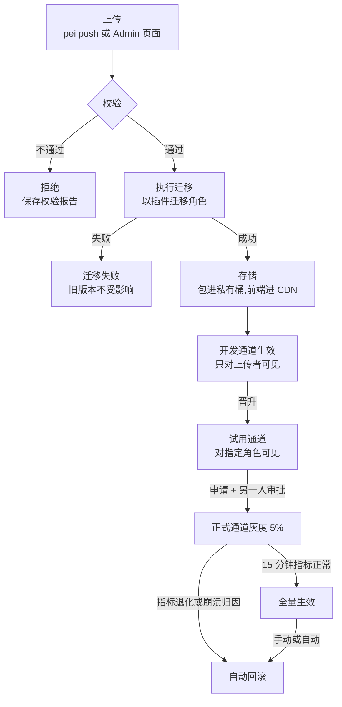

# 05 插件注册表与发布流程(草案 v0.1)

本文是 Admin 第一版的另一半核心:插件从上传到上线、晋升、回滚的完整流程,以及支撑它的数据表。

数据表见 [`kernel/db/migrations/0002_plugin_registry.sql`](../../kernel/db/migrations/0002_plugin_registry.sql)。该脚本已在本地 PostgreSQL 上验证,包括第 5 节的插件数据库角色隔离测试。需要 PostgreSQL 16 或更高版本。

## 1. 数据表一览

| 表 | 内容 |
| --- | --- |
| `pools` | 三个宿主池;`trade` 是唯一开放内网出口的池 |
| `plugins` | 插件本身:ID、名称、负责团队、所在池、启停状态 |
| `plugin_versions` | 每个上传的版本:清单、包的 SHA-256、存储路径、校验报告、状态。上传后不可变,不删除 |
| `plugin_claims` | 全局唯一的占用:路由前缀、页面路由、数据库 schema、事件主题前缀、扩展点、上下文值。两个插件不可能占用同一个值 |
| `plugin_migrations` | 已执行的迁移脚本及其哈希。同名脚本内容一变,上传即被拒绝 |
| `plugin_channels` | 开发、试用、正式三个通道各自指向哪个版本,以及上一版本和灰度比例 |
| `channel_audiences` | 开发、试用通道的受众(用户或角色) |
| `release_requests` | 晋升到正式通道的申请与审批;同一插件同时只能有一个待审批申请 |
| `release_events` | 发布历史:每次指针变化、池迁移、启停 |
| `host_instances`、`instance_plugins` | 宿主实例的心跳,以及每个实例上每个插件版本的加载状态 |
| `plugin_incidents` | 崩溃归因、卡死、错误率、发布后退化。自动回滚的判断依据 |
| `plugin_secrets` | 插件密钥的引用;值在 Secret Manager 中 |
| `api_tokens` | 命令行工具 `pei push` 用的个人访问令牌,只存哈希 |
| `kernel_settings` | 发布相关的设置:是否要求两人审批、灰度比例与时长、包大小上限 |
| `registry_version` | 注册表版本号。插件、通道、受众、池变化时由触发器加一,网关和宿主据此立即刷新 |

## 2. 发布流程

### 2.1 上传

- 来源:命令行 `pei push`(用个人访问令牌,需 `kernel:admin.plugins.publish`)或 Admin 页面上传。
- 包上限 50 MB(可在设置中调整)。Admin 边接收边计算 SHA-256,先放入私有桶的临时区。

### 2.2 校验

全部在内存中完成,不落本地磁盘。任何一项不通过,版本状态为 `rejected`,校验报告保存在版本记录里,Admin 和命令行都能看到。

| 类别 | 检查内容 |
| --- | --- |
| 包结构 | 只允许 `manifest.json`、`backend/`、`frontend/`、`migrations/`;不得包含契约程序集或 ASP.NET Core 共享框架的程序集 |
| 清单 | 通过 JSON Schema;版本号高于该插件已有的最高版本;`sdk` 范围包含内核当前提供的契约版本 |
| 程序集扫描 | 拒绝:直接使用套接字、自行创建 `HttpClient`、创建线程或 `Timer`、`Environment.Exit` / `FailFast`、启动进程、读写本地文件 |
| 引用完整性 | 01 号文档列出的六项:权限点、扩展点、视图、接口、占用冲突、内网出口与池 |
| 只增不改 | 与当前正式版本的清单对比:权限点、工具、视图、扩展点、事件不得删除;工具风险不得调低 |
| 迁移脚本 | 已执行过的脚本内容不得变化;新脚本只能追加在末尾 |
| 新增权限 | 新增的权限点或出站目标会被标记,晋升到正式通道时需要管理员额外确认 |

### 2.3 执行迁移

1. 第一次发布的插件,先调用 `core.ensure_plugin_roles` 创建它的两个数据库角色(见第 5 节),密码由 Admin 随机生成,存入 Secret Manager。
2. 用 `pg_try_advisory_lock` 按插件加锁,防止同一插件的两次发布同时迁移。
3. **以该插件的迁移角色直接登录**,按文件名顺序执行尚未执行过的脚本,每个文件一个事务,记录到 `plugin_migrations`。
4. 若有其他插件声明读取本插件的视图,迁移后为它们的运行角色授予 `select`。
5. 任何一步失败,版本状态为 `migration_failed`。由于脚本只增不改,旧版本照常运行;修正后用新版本号重新上传即可。

### 2.4 存储

- 后端包写入私有桶的不可变路径 `plugins/{插件id}/{版本}/{sha256}.zip`。
- 前端产物解压到 CDN 桶的 `assets/{插件id}/{版本}/`,永久缓存;不同版本的文件互不覆盖。
- 版本状态变为 `available`。

### 2.5 通道与晋升

| 通道 | 谁能看到 | 怎么进入 | 审批 |
| --- | --- | --- | --- |
| 开发 | 上传者,以及受众中的用户和角色 | 上传成功后自动进入 | 无 |
| 试用 | 受众中的角色 | 有 `publish` 权限的人晋升 | 无 |
| 正式 | 所有有该插件权限的用户 | 提交申请,另一位有 `promote` 权限的人批准 | 默认不能自己批自己 |

网关为每个请求选版本的顺序:用户在开发通道受众中,用开发版本;否则在试用通道受众中,用试用版本;否则用正式版本。正式版本处于灰度期间,按用户 ID 分桶决定用新版本还是上一版本。

### 2.6 灰度与回滚

- 正式通道的新版本先对 5% 的用户生效 15 分钟,通过后全量。判断标准见 03 号文档第 7 节。
- **手动回滚**:有 `promote` 权限的人在 Admin 中一键回滚,即把指针指回 `previous_version`。
- **自动回滚**:灰度期指标退化,或 03 号文档第 6 节的崩溃归因成立。
- 每次指针变化都写一条 `release_events`,并写审计。

### 2.7 其他操作

| 操作 | 做法 |
| --- | --- |
| 迁移到另一个池 | 目标池先加载,网关切换路由,原池再卸载。不需要重新发布 |
| 停用插件 | 宿主卸载它,网关返回 404,界面上不再显示。数据保留,随时可以重新启用 |
| 按租户启用 | 见 04 号文档 |
| 删除插件 | 不提供。版本和数据都保留,只能停用 |

## 3. 宿主如何得知要加载什么

1. 宿主启动时,读取本池所有启用插件在各通道指向的版本(包括灰度中的上一版本),逐个加载。
2. 之后订阅 Redis 中注册表版本号的变化,收不到通知时每 30 秒轮询一次。
3. 版本号变了,就重新计算本池应加载的版本集合:加载新增的,排空并卸载多余的。
4. 每 10 秒写一次心跳,并更新 `instance_plugins` 中每个版本的状态。网关只在一个版本在本池**所有存活实例**上都处于 `serving` 后才把流量切给它。

## 4. Admin 第一版的插件相关页面

| 页面 | 功能 |
| --- | --- |
| 插件列表 | 每个插件的三个通道版本、所在池、健康状态、最近事故 |
| 上传 | 拖入 zip,实时显示校验和迁移进度,结束后显示校验报告 |
| 插件详情 | 版本历史与校验报告、通道与受众、灰度进度、发布历史、事故、密钥、已执行的迁移 |
| 待审批 | 晋升到正式通道的申请;审批时显示与当前正式版本的清单差异,新增权限和出站目标高亮 |
| 池与实例 | 每个池的实例、心跳、内存、泄漏计数,以及每个实例上加载的插件版本 |
| 设置 | 两人审批、灰度比例与时长、包大小上限 |
| 访问令牌 | 为 `pei push` 创建和吊销个人访问令牌 |

## 5. 插件的数据库角色

每个插件有两个数据库**登录角色**,由 `core.ensure_plugin_roles` 创建:

| 角色 | 用途 | 权限 |
| --- | --- | --- |
| `plg_{schema}_owner` | Admin 执行迁移时登录 | 拥有插件自己的 schema,可以建表改表;最多 2 个连接 |
| `plg_{schema}_rt` | 宿主运行时登录 | 只有增删改查;连接数上限和语句超时来自清单 `limits` |

**两个角色都是直接登录,而不是由内核连接后再切换过去。** 如果内核先以自己的身份连接,再 `SET ROLE` 到插件角色,插件的 SQL 只要执行一句 `RESET ROLE` 就能拿回内核的权限。直接登录则没有这个退路。

在本地 PostgreSQL 上的实测结果:

| 测试 | 结果 |
| --- | --- |
| 迁移角色执行示例插件的建表脚本,连续两次 | 都成功,幂等 |
| 运行角色增删改查 | 成功 |
| 运行角色建表、删表 | 被拒绝 |
| 运行角色或迁移角色读取、删除 `core` 中的表 | 被拒绝 |
| 运行角色执行 `RESET ROLE` 后读取 `core` | 被拒绝 |
| 运行角色或迁移角色 `SET ROLE pei_kernel` | 被拒绝 |
| 运行角色执行 6 秒的查询(超时设为 5 秒) | 被数据库中止 |
| 两个插件占用同一个 schema 名 | 被唯一约束拒绝 |
| 同一插件同时提交两个待审批申请 | 被唯一约束拒绝 |

## 6. 待定

- 程序集扫描的规则清单需要在 PoC 中按真实插件校准,避免误报。
- 包签名(在 SHA-256 之外由发布者签名)第一版不做;若安全团队要求,再加。
- 插件版本和包的保留策略:建议永久保留所有进入过正式通道的版本,其余保留最近 20 个。
